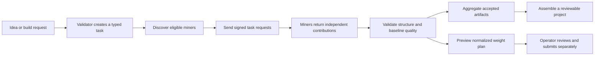

# Subnet Factory

**From a subnet idea to a reviewable project blueprint — built around Bittensor's miner and validator model.**

Subnet Factory is a decentralized engineering workflow for discovering subnet opportunities, turning approved requirements into structured tasks, collecting independent miner contributions, and assembling validator-approved project artifacts.

It is designed as a native Bittensor subnet project. The repository uses the Bittensor Python SDK and follows its miner/validator participation model; it does **not** claim that a public Factory subnet is currently registered or running.

## Why Subnet Factory

Launching a subnet involves more than writing code. Teams need a clear commodity, a way to measure useful work, a coherent protocol, and enough implementation detail to test an idea. Subnet Factory brings those early steps into one contribution and review loop:

- **Explore opportunities** with explicit users, demand, verification methods, and risks.
- **Turn decisions into engineering tasks** with typed, bounded specifications.
- **Invite independent miner work** rather than treating a central coordinator as the source of every artifact.
- **Check contributions consistently** before they can be aggregated into a project.
- **Keep chain actions deliberate**: weight plans are previews, and submission requires a separate operator action.

## How it works



### Participant roles

| Participant | Responsibility |
| --- | --- |
| **Miner** | Responds to bounded discovery, architecture, or generation tasks with a typed contribution. Each operator controls their own generation runtime. |
| **Validator** | Discovers peers, signs requests with its Bittensor hotkey, checks validator eligibility, validates returned work, and prepares reviewable weight plans. |
| **Factory coordinator** | Queues work, reports progress, applies the baseline checks, and assembles compatible, accepted files. It does not silently replace miner work with centralized generation. |

### Contribution lifecycle

1. **Specify** — A request becomes a typed task with an explicit kind, output requirements, SDK target, and deadline.
2. **Dispatch** — The validator discovers eligible miners through the Bittensor metagraph and sends each miner an authenticated request.
3. **Contribute** — Miners return structured suggestions, architecture, or project files using shared Pydantic contracts.
4. **Validate** — The validator checks task matching, required outputs, safe and unique paths, Python syntax, and baseline secret-pattern signals. Scores are based on transparent checks, not output length.
5. **Assemble** — Accepted files are combined only when paths are safe and contributions do not conflict. A manifest records accepted contribution IDs and file hashes.
6. **Review weights** — Scores can be normalized into a weight-plan preview. An operator must explicitly submit a reviewed plan through the separate CLI.

## What is implemented

- Typed task, contribution, validation-report, and weight-plan contracts.
- Discovery, architecture, and project-generation task flows.
- Bittensor SDK integration for metagraph peer discovery and hotkey-signed validator-to-miner HTTP requests.
- Miner-side request verification and validator eligibility checks.
- Deterministic baseline validation and conflict-aware project assembly.
- A FastAPI service, persistent SQLite task journal, single-worker build queue, and replayable Server-Sent Events progress.
- A separate interactive CLI for operator-confirmed weight submission.

## Status and scope

This is an **active prototype**, not a production-ready public subnet. The local workflow has been exercised with a test miner fixture, including local chain-mode peer discovery and signed requests. These checks do not establish that the Factory is registered on a public Bittensor network or that a public miner fleet is online.

| Capability | Current status |
| --- | --- |
| Core miner/validator workflow | Implemented; local integration paths documented |
| Local artifact build and retrieval | Smoke-tested with a test-only miner fixture |
| Public Factory subnet registration | Not completed |
| Automated weight transactions | Not enabled; plans are preview-only until an operator submits them |
| Isolated execution of generated code | Not provided by the current generator command; generated artifacts must be treated as untrusted |
| Horizontal scaling | Not supported by the single-host SQLite queue |

The current validator checks are a useful baseline, **not a proof of correctness or security**. Before production use, generated code needs isolated, resource-limited execution; stronger testing and review; and a shared queue and artifact store for multi-host operation. See the [build test record](docs/build-test-record.md) for what has and has not been verified.

## Quick start

Requires Python 3.10–3.14 and [`uv`](https://docs.astral.sh/uv/).

```sh
uv venv
source .venv/bin/activate
uv pip install -e '.[dev]'
FACTORY_LOCAL_MODE=1 uv run uvicorn subnet_factory.api:app --reload
```

Open `http://127.0.0.1:8000/docs` to explore the API. This starts the API in local development mode; it does not register a subnet, start miners, or execute a build. Follow the [localnet guide](docs/localnet.md) to run the full local miner/validator workflow.

## Documentation

- [Architecture and trust boundaries](docs/architecture.md)
- [Localnet setup and operator workflow](docs/localnet.md)
- [Build and test record](docs/build-test-record.md)
- [Example server-side client](examples/tensor_studio_factory_client.ts)

## Built with the Bittensor ecosystem

Subnet Factory pins **Bittensor SDK 11.3.0** and is organized around Bittensor's subnet roles: miners provide work, validators evaluate it, and chain weight submission remains an explicit network operation. For network concepts, SDK usage, and local development, start with the [official Bittensor documentation](https://www.bittensor.com/docs), [SDK quickstart](https://www.bittensor.com/docs/quickstart), and [local development guide](https://www.bittensor.com/docs/guides/local-development).

## Safety by design

- Chain registration, subnet activation, and weight submission are not triggered automatically by a build request.
- Local development mode is for trusted loopback testing only and must not be exposed publicly.
- Treat prompts, miner output, generated code, and dependencies as untrusted input.
- Do not run generated code or untrusted generator commands with privileged access.
- Use the operator guides before configuring wallets or exposing the API.
